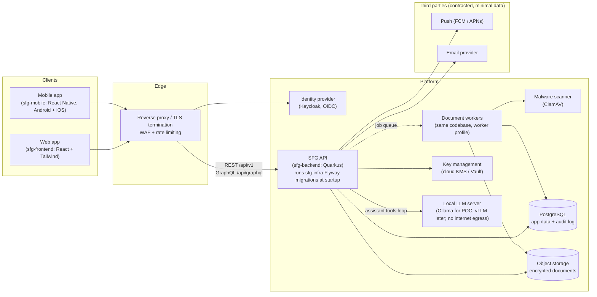
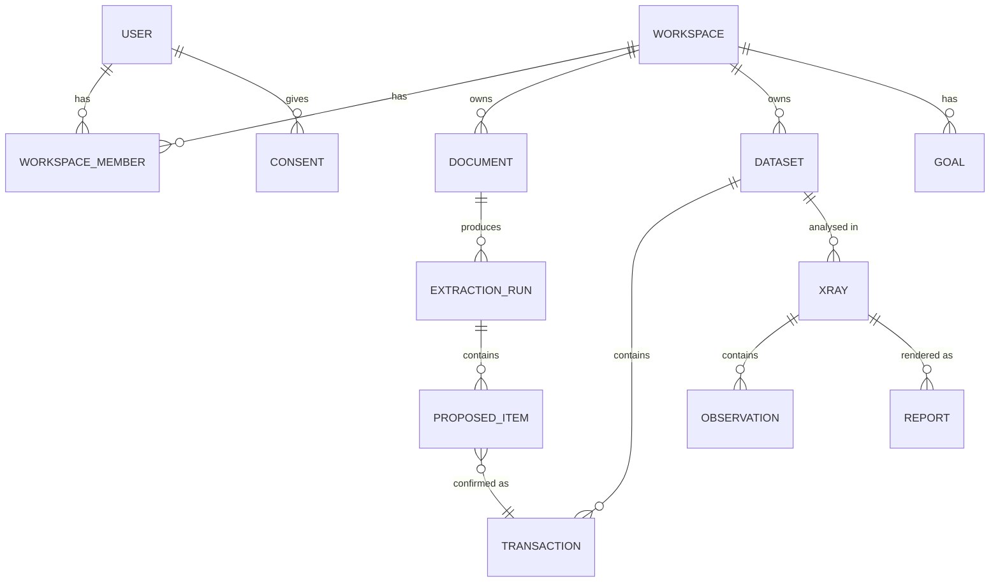
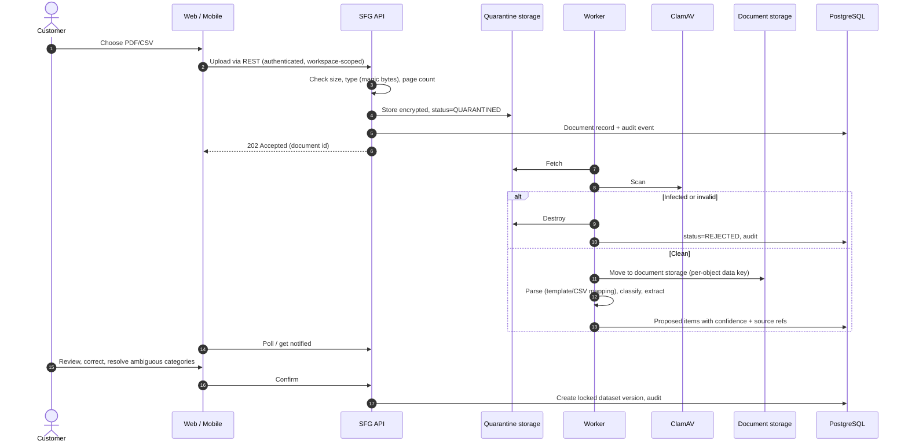
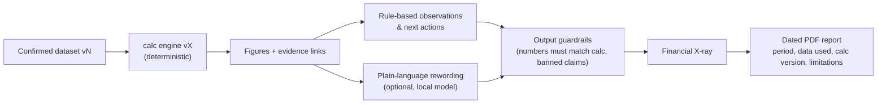
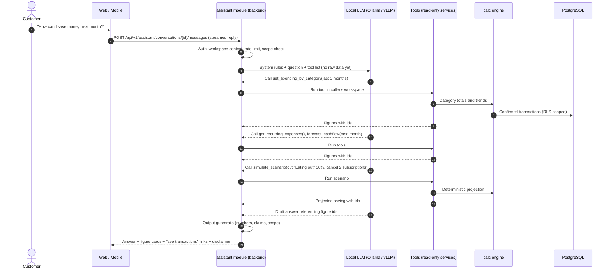
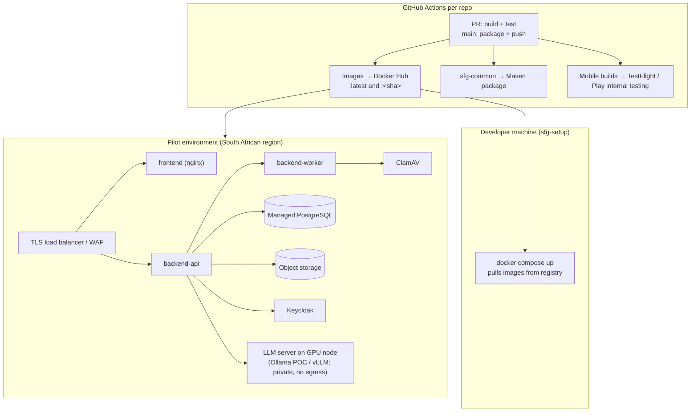

# SFG (Set Financial Goals): High-Level Design

| | |
|---|---|
| **Status** | Draft v0.2 for review (v0.2: REST + GraphQL, sfg-infra, Docker Hub CI, sfg-common as the shared Java data library, local AI assistant) |
| **Date** | 24 November 2026 |
| **Source** | *SFG Technical Development, Cybersecurity & Data Protection Brief* (Finance Blueprint (Pty) Ltd, 22 October 2026) |
| **Scope** | First release and controlled Johannesburg pilot (about 100 participants: 70 individuals, 30 small businesses) |

This document describes the target architecture for the SFG first release. It turns the brief into
components, data flows and controls, and lists the decisions that still need an owner. Items marked
**[Decision]** are proposals made here that should be confirmed; items marked **[Open]** are listed in
[section 12](#12-open-questions).

> **Product focus: AI is the main driver.** What sets SFG apart is that a customer, above all a small
> business owner, can ask questions about their own finances in plain language and get trustworthy,
> evidence-backed answers ("How can I save money next month?"). That assistant, **Ask SFG**, is the centre
> of the product, not an add-on. Uploads, extraction, customer review and the deterministic calculation
> engine exist to give it accurate, confirmed data and reliable numbers. The AI runs on local models only,
> so customer financial data never goes to a cloud AI service. See [section 7](#7-ai-assistant-ask-sfg-and-safeguards).

---

## 1. Goals and constraints

### 1.1 What the first release must do

From the brief (section 3):

**Ask SFG, the AI assistant (core driver)**
- Customers, especially small business owners, ask questions about their own data in plain language ("How can I save money next month?", "Why was March negative?", "What if I cut fuel by 15%?") and get answers grounded in their figures, with the evidence shown.
- Available in both personal and business workspaces. Runs on local models only, so financial data never goes to a cloud AI (section 7).
- The brief frames AI as assisting with explanations and guidance (3.3); Ask SFG does exactly that, with the calculation engine producing every number.

**Personal financial health**
- Onboarding and profile setup.
- Secure upload of payslips, about three months of bank statements, and optional debt documents.
- **Automatic import and categorisation of bank statements** (CSV first, then PDF), with low-confidence categories flagged for the customer (section 5.4).
- Extraction of data from those documents, shown to the customer for review and correction.
- A confirmation step where the customer resolves ambiguous transaction categories or extracted values.
- A **Financial X-ray**: cash flow, debt, savings, progress towards goals.
- Transparent, evidence-based observations and suggested next actions. The customer keeps decision-making control.
- Goal setup and tracking, weekly progress notifications, and a 30-day review.
- Dated financial-health reports that state the reporting period, the data used, and limitations.

**Basic small-business (SME) pilot**
- Secure upload of business bank statements and invoices.
- Basic business cash-flow visibility and goal planning.
- Separation of personal and business records, including when one person uses both.
- Limited decision support suitable for a controlled pilot.

### 1.2 Design principles (from brief 3.3 and section 4)

1. **Security and privacy first.** Secure upload and processing come before features. No live pilot with real data until legal/privacy review, controls, testing and approvals are complete.
2. **Documents in, not bank feeds.** PDF and CSV uploads only. No direct bank integrations and no promise of automatic monitoring in release 1.
3. **Deterministic numbers.** Every financial figure comes from a deterministic, versioned, tested and auditable calculation engine. AI may explain, answer questions and suggest, but never calculates the numbers or overrides calculation controls.
4. **Customer in control.** Extracted data is a proposal until the customer confirms it. Suggestions are advice, not decisions.
5. **No credit-score claims.** Credit-readiness guidance is never presented as a bureau score or a lending decision.
6. **Local AI only.** Language models run on SFG-controlled infrastructure in South Africa; customer data is never sent to a cloud AI service.
7. **Proportionate.** Sized for a 100-person pilot. Prefer a small number of well-understood components over a distributed platform.

### 1.3 Explicit non-goals for release 1

- Direct bank / open-banking integrations.
- Automatic, continuous account monitoring.
- Official credit scores or lending decisions.
- Formats other than PDF and CSV (unless confirmed during design, see [Open] Q4).
- Multi-user business accounts (accountant/staff access), unless confirmed (Q9).
- High-scale, multi-region infrastructure.

---

## 2. Architecture overview

SFG is built as **one backend service (a modular monolith) with two clients**. For a pilot of this size,
a single deployable backend with strong internal module boundaries is cheaper to secure, test and operate
than microservices, and modules can be split out later if needed. **[Decision]**

The **Ask SFG assistant** is a first-class part of this architecture: every financial feature in the
backend (cash flow, spending, debts, goals, SME receivables and payables, scenarios) is built as a service
that the app screens **and** the assistant's tools both call. A feature is not done until the assistant
can use it.



**Key technology choices** (proposals, to confirm in Stage 1):

| Concern | Choice | Why |
|---|---|---|
| Backend | Quarkus (Java 21 LTS) | Stated in project setup; strong OIDC, security and native-image support |
| API style | REST (`/api/v1`, OpenAPI) **and** GraphQL (`/api/graphql`, SmallRye GraphQL) over one shared service layer | REST for simple, cacheable and file-upload calls; GraphQL lets the X-ray and dashboard screens fetch exactly what they need in one round trip |
| Schema migrations | Flyway, owned by the separate **sfg-infra** repo, applied by the backend at startup | Schema changes are reviewed and versioned on their own; Hibernate never generates DDL, only validates |
| Database | PostgreSQL 16 | Relational integrity for financial data; row-level security for tenant separation |
| Document storage | S3-compatible object storage (MinIO locally, cloud bucket in pilot) | Keeps large binaries out of the DB; per-object encryption and lifecycle rules |
| Identity | Keycloak (self-hosted) **[Decision]** | Open source, OIDC/PKCE, MFA, runs in docker-compose; avoids per-user SaaS fees and keeps identity data in-region |
| Async jobs | PostgreSQL-backed job queue (e.g. Quartz/JobRunr or `SKIP LOCKED` table) **[Decision]** | Pilot volumes are tiny; avoids running Kafka/RabbitMQ |
| Malware scanning | ClamAV sidecar | Uploaded files are untrusted input |
| AI | Local open-weight LLM, served by **Ollama for the POC** (decided) and swappable to vLLM by configuration, called via Quarkus LangChain4j with read-only tools | Customers can ask questions about their data without any financial data going to a cloud AI (section 7) |
| Hosting | Containers in a South African cloud region (e.g. AWS af-south-1 or Azure South Africa North) **[Open] Q1** | Keeps personal information in-country, simplifies POPIA section 72 |

---

## 3. Repositories and components

All repositories live at `github.com/sdebie`.

| Repo | Purpose | Main contents |
|---|---|---|
| **sfg-parent** | Project documentation and cross-repo decisions | This HLD, architecture decision records (`docs/adr/`), threat model, security and POPIA control register, roadmap |
| **sfg-infra** | Database schema and local database | Flyway migrations (`db/migration`), dev seed data (`db/seed/dev`), a `docker-compose.yml` for a local PostgreSQL. Publishes the migrations as a Maven jar that the backend applies at startup |
| **sfg-setup** | Run the whole system locally and for the pilot | `docker-compose.yml`, env templates, startup and seed scripts. Compose **pulls** published images (details deferred) |
| **sfg-common** | Shared Java library and owner of the data model | Enums, JPA entities, DTOs and Panache repositories, published as a Maven artifact |
| **sfg-backend** | The SFG API and document workers | Quarkus application (REST + GraphQL), services, calculation engine. Uses the entities, DTOs and repositories from sfg-common; no DDL |
| **sfg-frontend** | Customer web app | React + Tailwind SPA |
| **sfg-mobile** | Customer mobile app | React Native app for Android and iOS |

### 3.1 sfg-backend (Quarkus)

A single Quarkus application, deployed in two roles from the same image: **api** (serves HTTP) and
**worker** (processes document jobs). Internal modules, each with its own package and tests (their entities and repositories live in sfg-common, section 3.4):

| Module | Responsibility |
|---|---|
| `identity` | Maps OIDC identities to SFG users; profile; consent records; MFA enforcement hooks |
| `workspace` | Personal and business workspaces, membership, and the tenant context applied to every request |
| `documents` | Upload intake, validation, quarantine, malware scan, encrypted storage, retention and deletion |
| `extraction` | Parsers for PDF and CSV (payslips, bank statements, invoices, debt documents); produces *proposed* data with confidence scores and source references (page/line) |
| `categorisation` | Turns imported transactions into categories: workspace rules, system rules, shared merchant map, then the local LLM, with confidence and source recorded (5.4) |
| `review` | Customer review and correction of extracted data; ambiguous-category resolution; confirmation and locking of a dataset |
| `ledger` | Confirmed transactions, categories, income, debts and balances per workspace |
| `calc` | **Deterministic calculation engine**: cash flow, debt ratios, savings rate, goal projections, SME cash-flow. Pure functions, `BigDecimal`, versioned, no I/O |
| `xray` | Assembles the Financial X-ray from `calc` outputs, with evidence links back to source transactions |
| `goals` | Goal setup, progress tracking, the 30-day review schedule |
| `guidance` | Rule-based observations and next actions; optional plain-language rewording by the local model (section 7) |
| `assistant` | "Ask SFG": conversations, tool-calling loop against the local LLM, read-only tools over `calc`/`ledger`/`goals`, guardrails, streaming answers (section 7) |
| `reports` | Dated PDF reports with period, data used, calc version and limitations |
| `notifications` | Weekly progress and review reminders via push and email; user preferences |
| `audit` | Append-only audit log of security and data events |
| `admin` | Minimal operator functions for the pilot (support lookup, deletion requests) with strict, audited access |

Notes:
- **Calculation engine discipline.** `calc` has no dependency on frameworks or AI. Each run records the engine version and a hash of its inputs, so any figure in a report can be reproduced. Golden test vectors (agreed with Finance Blueprint) gate every change.
- **Persistence.** Hibernate ORM with Panache, with `quarkus.hibernate-orm.database.generation=none`. Entities, enums and repositories come from sfg-common (3.4); the DDL comes only from sfg-infra (3.6), which the backend applies with Flyway at startup; Hibernate runs in `validate` mode in tests. All workspace-owned tables carry `workspace_id`.
- **APIs.** Two front doors onto the same services:
  - **REST/JSON** under `/api/v1` (JAX-RS), with OpenAPI generated by SmallRye OpenAPI at `/q/openapi` and published to sfg-common. Used for uploads, downloads (reports), commands and anything that benefits from plain HTTP semantics.
  - **GraphQL** at `/api/graphql` (SmallRye GraphQL). Used for read-heavy screens such as the Financial X-ray, goals and dashboards. Mutations are allowed where they mirror a REST command.
  - Both call the same `service` layer and share DTOs, so validation, authorization and audit happen once, in the service, not in each API. Resources stay thin.
  - GraphQL-specific controls: query depth and complexity limits, no introspection or GraphQL UI in production, and errors that do not leak internals.
- **Code layout.** `api/rest`, `api/graphql`, `mapper` (MapStruct), `service`, `exception`, with the modules above as sub-packages as they arrive. `dto` and `entity` move to sfg-common. `Workspace` is the first worked example end to end.
- **Operations endpoints.** `/q/health` and `/q/metrics` (Prometheus), restricted at the reverse proxy.

### 3.2 sfg-frontend (React + Tailwind)

- Vite + React + TypeScript + Tailwind CSS.
- Routing by workspace (`/w/:workspaceId/...`) with a clear personal/business switcher and visual distinction between modes.
- Main areas: onboarding, uploads, review and confirm, Financial X-ray, **Ask SFG** assistant, goals, reports, settings (consent, notifications, data export/deletion).
- Uses a typed API client generated from the backend's OpenAPI document and GraphQL schema (where it lives: **[Open] Q17**).
- **Session model [Decision]:** the backend acts as a backend-for-frontend for the web app. Quarkus OIDC handles the login redirect and keeps the session in an `HttpOnly`, `Secure`, `SameSite=Strict` cookie, so access tokens are never exposed to browser JavaScript. Strict Content Security Policy; no third-party scripts or trackers on authenticated pages.
- Served as static files by nginx (own container image).

### 3.3 sfg-mobile (React Native)

- React Native with TypeScript for Android and iOS (Expo with a custom dev client is an option, **[Open] Q7**).
- Same feature set as web; document capture from files and, if confirmed, from the camera (Q4).
- **Auth:** OIDC Authorization Code + PKCE via the system browser (AppAuth). Refresh tokens stored in the iOS Keychain / Android Keystore only; short-lived access tokens kept in memory. Optional biometric unlock.
- **On-device data:** no financial documents or reports cached at rest beyond the current session; uploaded files are removed from app storage after a successful upload. Sensitive screens hidden from the app switcher and, on Android, protected against screenshots.
- Push notifications via FCM (Android) and APNs (iOS); notification content carries no financial figures (for example, "Your weekly progress update is ready").
- Uses the same generated client and types as the web app (Q17).

### 3.4 sfg-common (shared Java library, owner of the data model)

Confirmed (Q8): sfg-common is a **Java library** where shared resources live. It owns the database model
on the Java side.

- **Enums:** workspace type, document type and status, transaction categories, goal types, and similar domain values.
- **Entities:** the Hibernate ORM / Panache JPA entities that map the PostgreSQL tables.
- **DTOs:** request and response records used by both the REST and GraphQL APIs.
- **Repositories:** Panache repositories and shared queries over those entities, including the workspace scoping every query must apply (6.2).
- **No HTTP and no business logic:** resources, services, the calculation engine and guidance stay in sfg-backend.

How it fits with the other repos:
- **Build and publish:** a Maven jar (`org.sfg.common:sfg-common`) with a Jandex index so Quarkus apps discover its entities and repository beans. `build.yml` builds it on PRs; `publish-common.yml` deploys it to GitHub Packages on push to `main`.
- **sfg-backend** depends on it as a Maven dependency (or a local `mvn install` during development) and keeps only services, mappers and API resources. Backend CI reads the package from GitHub Packages (see 10 for the token it needs). sfg-common must be published before a backend change that needs it can pass CI.
- **sfg-infra** holds the Flyway migrations (DDL). sfg-common entities and sfg-infra migrations must change together: a change that adds a column lands as an sfg-infra migration plus the matching sfg-common entity change, released in that order. Drift is caught in backend CI: tests apply the real migrations and Hibernate validates the entities against them, so a missing or renamed column fails the build.
- **Web and mobile** cannot use a Java library. Their TypeScript types come from the backend's OpenAPI document and GraphQL schema instead; where that generated client lives is **[Open] Q17**.

### 3.5 sfg-setup

- `docker-compose.yml` that pulls published images from Docker Hub for: `backend-api`, `backend-worker`, `frontend`, `postgres`, `keycloak`, `minio`, `clamav`, and for local use only `mailpit` (fake email). The backend applies pending migrations itself when it starts (3.6).
- `.env.example` with every setting documented; no real secrets committed.
- Startup scripts: create buckets, import the Keycloak realm, load synthetic seed data. Migrations need no separate step because the backend applies them on startup; the sfg-infra runner can still load the dev seed.
- The same compose definition can run a single-host pilot environment with production overrides, or be translated to the chosen cloud platform later (details deferred, see section 10).

### 3.6 sfg-infra (database schema)

- **Owns the PostgreSQL schema.** Versioned Flyway migrations in `src/main/resources/db/migration` (starting with `V1.0.0__initial_schema.sql`) and synthetic seed data in `db/seed/dev`, which is never applied outside dev and test.
- **Local database:** its `docker-compose.yml` starts PostgreSQL 16 for development (`sfg_db`, user `sfg`).
- **Packaging:** sfg-infra publishes its migrations to GitHub Packages as a Maven artifact (`org.sfg.infra:sfg-infra:<version>:migrations`).
- **Applying migrations:** sfg-backend depends on that artifact and runs Flyway at startup in every profile (`quarkus.flyway.migrate-at-start=true`, `locations=classpath:db/migration`). `ignore-migration-patterns=repeatable:missing` lets a database that holds the sfg-infra dev seed (`R__dev_seed`) still validate. sfg-infra's own runner is still useful for loading the dev seed locally. Row-level security policies (6.2) will also arrive as sfg-infra migrations.
- **Database roles:** because the backend now applies migrations, its database user owns the tables. A table owner bypasses row-level security unless the policy is forced, so RLS migrations must use `ALTER TABLE ... FORCE ROW LEVEL SECURITY`. **[Decision]** Before the pilot, consider splitting roles: a schema-owner role used only for migrations and a lower-privilege application role for normal queries.
- **Relationship to sfg-common:** sfg-infra owns the DDL, sfg-common owns the entities that map it (3.4). Backend tests catch any drift.
- **How the backend tests use it:** Quarkus Dev Services starts a throwaway PostgreSQL 16, Flyway applies the real migrations from the sfg-infra artifact, and Hibernate runs in `validate` mode. Tests create their own data rather than relying on the dev seed. No sibling checkout is needed.
- **Access:** sfg-infra is private, and GitHub's built-in workflow token can't read another private repo's package, so backend CI needs a `PACKAGES_READ_TOKEN` secret (a classic PAT with `read:packages`), or sfg-infra must be made public.
- **Rules for schema changes:** migrations are forward-only and never edited after merge; a backend change that needs a new column merges the sfg-infra migration first; destructive changes go through expand-then-contract across two releases.

---

## 4. Domain model (simplified)



- **User:** one person, linked to an identity in Keycloak.
- **Workspace:** the unit of data separation. Type `PERSONAL` or `BUSINESS`. A user has at most one personal workspace and zero or more business workspaces.
- **Dataset:** a confirmed, locked set of transactions and figures for a period. X-rays and reports always point at a specific dataset version, so a dated report is reproducible.
- **Proposed item vs transaction:** extraction output stays a *proposal* until the customer confirms it; only confirmed data feeds `calc`.

---

## 5. Key data flows

### 5.1 Document upload, extraction and review



Extraction strategy **[Decision]** (bank statements are covered in detail in 5.4):
1. **CSV:** deterministic column mapping per known bank format, with a manual mapping fallback.
2. **Text-based PDF:** text extraction (Apache PDFBox/Tika) plus bank- and payslip-specific templates for the main South African banks and common payroll formats.
3. **Scanned or unknown PDFs:** marked "needs manual entry" in release 1, or OCR if confirmed (Q4). AI-based extraction, if used at all, is only an assistant that pre-fills proposals, under the same safeguards as section 7, and never skips the customer review.

### 5.2 Financial X-ray, guidance and report



- Every figure shown links back to the transactions it came from ("why am I seeing this?").
- Observations are generated from rules first; AI only rewords and explains them in plain language.
- Reports are immutable once generated and record dataset version, calc version, generation date and the standard limitations text.

### 5.3 Goals and notifications

- A scheduled job runs weekly per workspace, recomputes goal progress from the latest confirmed dataset, and sends a progress notification (push and/or email per user preference).
- A 30-day review is scheduled at goal creation and prompts the customer to upload newer statements and revisit the plan.
- Because there is no bank feed, progress reflects the data the customer has uploaded; the UI says so (brief 3.3).

### 5.4 Bank statement import and automatic categorisation

Importing bank statements and grouping transactions into categories automatically is a core feature:
every X-ray figure, goal projection and Ask SFG answer about spending depends on it. The design has two
parts: **import** turns any supported statement into one clean, verified list of transactions, and
**categorisation** assigns each transaction a category, cheapest and most predictable method first.

```mermaid
flowchart LR
  F["Uploaded statement<br/>(CSV, OFX, PDF)"] --> DET["Detect bank + format"]
  DET --> P["Per-bank parser<br/>(versioned)"]
  P --> N["Normalise<br/>one transaction shape"]
  N --> V{"Balances reconcile?<br/>Period covered?"}
  V -- no --> FLAG["Flag statement<br/>for review"]
  V -- yes --> D["De-duplicate<br/>+ detect own transfers"]
  D --> C1["1. Workspace rules<br/>(from corrections)"]
  C1 -->|unmatched| C2["2. System rules<br/>(fees, interest, cash, salary)"]
  C2 -->|unmatched| C3["3. Shared merchant map<br/>+ similar-merchant lookup"]
  C3 -->|unmatched| C4["4. Local LLM (Ollama)<br/>fixed category list + confidence"]
  C4 --> R{"Confidence high?"}
  R -- yes --> OK["Proposed category"]
  R -- no --> REV["Needs review"]
  OK --> CONF["Customer review + confirm<br/>(corrections become rules)"]
  REV --> CONF
  CONF --> LEDGER["Confirmed dataset<br/>→ calc, X-ray, Ask SFG"]
```



#### Import

1. **Formats, in order of priority:**
   - **CSV:** every major South African bank lets customers download CSV. Simplest and most reliable, so it comes first.
   - **OFX/QFX** where a bank offers it (structured, easy to parse); confirm in Q4.
   - **Text-based PDF:** text extraction (Apache PDFBox) plus a template per bank and statement layout.
   - **Scanned PDFs or photos:** OCR (for example Tesseract) only if Q4 confirms it is needed; otherwise the customer is asked for a CSV or digital PDF.
2. **Bank and format detection:** each parser recognises its own files (CSV header row, PDF text markers such as the bank name and layout). Unknown files are not guessed at; the customer is asked to pick the bank or upload another format.
3. **One parser per bank and format, versioned.** Parsers live in the `extraction` module behind one interface, each with synthetic or redacted sample files as tests. Start with the banks most used by pilot participants (Q22); the usual candidates are Absa, Capitec, FNB, Nedbank, Standard Bank, TymeBank and Discovery Bank.
4. **Normalise to one transaction shape:** transaction date, value date, raw description, cleaned description, extracted merchant, transaction type (card purchase, debit order, EFT, cash withdrawal, fee, interest, salary), signed amount (`BigDecimal`, ZAR), running balance, masked account, and the source document, page and line, plus parser version.
5. **Verify before accepting:** the opening balance plus all transactions must equal the closing balance, and each row's running balance must follow from the previous one. The statement must cover the period it claims, without gaps. A statement that fails is flagged for review with the reason, never silently accepted.
6. **De-duplicate:** each transaction gets a fingerprint (account, date, amount, cleaned description, occurrence number that day), so overlapping statements and re-imports do not double count.
7. **Detect transfers between own accounts:** matching amounts with opposite signs within a few days, across accounts in the same workspace, are marked as transfers, not income or spending. Money moving between a person's personal and business workspaces is flagged as a transfer (for example owner drawings) in each workspace, without linking the data.
8. **Clean descriptions:** strip card numbers, POS prefixes, dates, reference numbers and location codes, so "POS PURCHASE 1234 WOOLWORTHS SANDTON 12/03" becomes merchant "Woolworths", type "card purchase".

#### Categorisation (cheapest first)

Each transaction goes through the steps below and stops at the first one that gives a confident answer.

1. **Workspace rules.** Rules the customer created by correcting a category ("always put *Joe's Plumbing* under *Repairs*"). Highest priority, because they reflect the customer's own view.
2. **System rules.** Deterministic rules on transaction type and known patterns: bank fees, interest, ATM cash withdrawals, debit orders to known insurers, salary credits matched to the uploaded payslip's employer.
3. **Shared merchant map.** A curated dictionary of cleaned merchant names to categories (for example Engen, Shell to *Fuel*; Checkers, Pick n Pay to *Groceries*), plus a similar-merchant lookup (pgvector embeddings from a local embedding model) for spelling variants. It contains businesses only, never private individuals' names. New entries come from corrections only after they are seen across several workspaces and reviewed by the team, so no customer-specific data enters the shared map.
4. **Local LLM (Ollama, the same server as Ask SFG).** Remaining transactions are sent in batches with only the cleaned description, transaction type, amount sign and workspace type. The model must answer with a category from the fixed list (structured JSON output, checked against the enum) and a confidence. It has no tools and cannot invent categories, so hostile text in a statement can at worst produce a wrong suggestion, which the customer review catches.
5. **Needs review.** Anything below the confidence threshold, or where steps disagree, is shown in the confirmation step (brief 3.1) for the customer to resolve.

**Learning from corrections:** when a customer changes a category, the app offers "apply to similar transactions?" and saves a workspace rule. Rules are visible and editable in settings.

**Category lists:** two lists, each with groups and categories, held as enums in sfg-common and signed off by Finance Blueprint (Q21).
- *Personal*, for example: income (salary, other income), housing, groceries, transport and fuel, utilities, insurance, debt repayments, eating out, entertainment, subscriptions, health, education, savings and investments, transfers, fees.
- *Business*, for example: sales income, cost of sales and stock, salaries and wages, rent, utilities, vehicle and fuel, marketing, software and subscriptions, professional fees, bank charges, tax (VAT, PAYE, SARS), loan repayments, owner drawings, transfers.

**Auditability:** every transaction stores where its category came from (rule id, system rule, merchant map, model and version, or customer) and the confidence. The X-ray and Ask SFG can explain "why is this under Groceries?". The calculation engine only uses categories from a **confirmed** dataset, so the model suggests but never decides a number.

**Measuring it:** track, per bank and per step, the share of transactions categorised automatically, the accuracy of automatic categories (measured on a labelled synthetic or consented set, and on customer corrections), and the review rate. Proposed POC targets, to be set from real data: at least 80% categorised automatically, with at least 95% of those correct.

**Performance:** three months of statements is typically a few hundred to about 1,500 transactions. Rules and the merchant map handle most of them, so the LLM sees only the remainder, in batches, in the background worker. The customer sees progress and can start reviewing straight away.

---

## 6. Security architecture

Mapped to brief section 4. A formal threat model (STRIDE per data flow above) is a Stage 1 deliverable and will refine these controls.

### 6.1 Identity, authentication and sessions
- OIDC via Keycloak. Web uses the backend-for-frontend cookie session; mobile uses Authorization Code + PKCE.
- **MFA required** for all customers (TOTP or passkeys/WebAuthn; SMS OTP only as a fallback, **[Open] Q6**).
- Strong password policy with breached-password checks, account lockout and throttling on login and OTP.
- Short access-token lifetime (5 to 10 minutes), rotating refresh tokens, idle session timeout (e.g. 15 minutes) and absolute timeout; re-authentication before sensitive actions (export, delete account, change MFA).

### 6.2 Authorization and personal/business separation
- Every request runs in a **workspace context**; the backend checks the caller's membership and role on that workspace for every call (deny by default).
- **Defence in depth:** PostgreSQL row-level security on all workspace-owned tables (forced, so it also applies to the table owner; see 3.6), with the workspace id set per transaction, so a missed check in code still cannot return another workspace's rows.
- Object storage keys are prefixed by workspace and never guessable; documents are only served through the API after an authorization check (no public URLs).
- Explicit UI separation between personal and business modes; no cross-workspace aggregation in release 1.
- Operator/admin access is separate (own realm or role, MFA, IP-restricted), least privilege, and every access is audited.

### 6.3 Encryption
- **In transit:** TLS 1.2+ (prefer 1.3) everywhere, HSTS on the web; TLS between internal services where the platform allows.
- **At rest:** encrypted database volumes and backups; object storage server-side encryption **plus** application-level envelope encryption of each document with its own data key wrapped by a KMS master key.
- **Sensitive fields** (SA ID number, account numbers) are encrypted at the column level and masked in the UI and logs.
- Keys live in a managed KMS or HashiCorp Vault, never in code or images; rotation documented.

### 6.4 Secure document handling
- Allow-list of types (PDF, CSV), validated by content, not extension. Size and page-count limits. PDFs with JavaScript or embedded files are rejected or sanitised.
- Quarantine, then malware scan, then promotion to document storage. Parsers run in the worker with limited privileges and resource limits.
- **Retention and deletion:** originals are kept only as long as needed for review and evidence (proposed: deleted 90 days after the dataset is confirmed, **[Open] Q3**); deletion removes the object and destroys its data key (crypto-shredding), so copies in backups become unreadable.

### 6.5 Audit logging and monitoring
- Append-only audit log for logins, MFA changes, uploads, views/downloads of documents and reports, confirmations, exports, deletions and all admin actions: who, what, when, from where, workspace.
- Application logs contain no document contents, no figures and no unmasked identifiers.
- Centralised logs and metrics with alerts for brute-force attempts, unusual download volumes, authorization failures and job failures. Monitoring level for the pilot to be agreed (**[Open] Q11**).

### 6.6 Secure development lifecycle
- Protected `main` branches, pull-request review, signed commits encouraged.
- CI (GitHub Actions) on every PR: build and tests, SAST (e.g. CodeQL/Semgrep), dependency scanning (Dependabot/Renovate, OWASP Dependency-Check, `npm audit`), secret scanning, container image scanning (Trivy), SBOM generation.
- Defined vulnerability handling: triage SLA by severity, remediation and retest.
- Only synthetic or anonymised data in development and test environments.

### 6.7 Backup, recovery and incident response
- Encrypted, automated database backups with point-in-time recovery; object storage versioning; backups kept in-region.
- Proposed pilot targets: RPO 24 hours or better, RTO 1 business day (**[Open] Q12**). A restore test is part of Stage 3.
- Incident response plan covering detection, containment, POPIA section 22 notification to the Information Regulator and affected customers, and post-incident review.

---

## 7. AI assistant ("Ask SFG") and safeguards

### 7.1 Purpose

The main driver for SFG is that a customer, especially a small business owner, can **ask questions about
their own data in plain language**, for example:

- "How can I save money next month?"
- "Why was my cash flow negative in March?"
- "Which customers owe me the most, and how late are they?"
- "If I cut my fuel spend by 15%, when do I reach my savings goal?"

The assistant answers using the customer's confirmed data, the deterministic calculation engine and
curated guidance, and shows the figures and transactions behind every answer. It fits the brief's rule
that "AI may assist with explanations and guidance, but should not replace calculation controls" (3.3):
**the model talks, the calculation engine counts.**

It replaces the earlier "explanations only" scope for AI and the plan to defer AI chat.

### 7.2 Local models only [Decision]

**Personal and business financial data never goes to a cloud AI service.** The language model runs on
infrastructure SFG controls, in South Africa, on a private network with no internet access.

- **Serving, POC (decided):** [Ollama](https://ollama.com), on a developer machine (for example a Mac with Apple Silicon) or a single GPU server. It is the quickest way to get a local model answering questions.
- **Serving, later:** [vLLM](https://github.com/vllm-project/vllm) once the pilot needs better throughput and batching, or any other server with an OpenAI-compatible API. Whether and when to switch is decided from the POC results.
- **Swappable by configuration [Decision]:** the backend uses the [Quarkus LangChain4j](https://docs.quarkiverse.io/quarkus-langchain4j/dev/) extension with its **OpenAI-compatible** client (`quarkus-langchain4j-openai`), not an Ollama-specific client. Ollama and vLLM both serve that API, so changing the serving engine or the model means changing only configuration, for example:

  ```properties
  # POC: Ollama
  quarkus.langchain4j.openai.base-url=${LLM_BASE_URL:http://localhost:11434/v1}
  quarkus.langchain4j.openai.chat-model.model-name=${LLM_MODEL:qwen3:14b}
  # Later: vLLM, same keys
  # LLM_BASE_URL=http://llm:8000/v1   LLM_MODEL=Qwen/Qwen3-32B
  ```

  Rules that keep it swappable: no code depends on Ollama-specific APIs or model-specific prompt formats; prompts, tools and guardrails live in the `assistant` module, not in the server; and the evaluation set (7.7) is rerun on every change of server or model, because tool-calling quality differs between models.
- **Integration:** tools are plain Java methods on backend services, exposed to the model through LangChain4j's tool support.
- **Model choice:** open-weight models with strong tool calling and a permissive commercial licence, chosen by running the evaluation set (7.7) on SFG's own synthetic data. Candidates to evaluate, as of late 2026:

| Size class | Example candidates | Typical GPU memory (quantised) | Fit |
|---|---|---|---|
| Small (about 7 to 14B) | Qwen3 8B/14B, Llama 3.1 8B, Gemma 3 12B | 16 to 24 GB (e.g. one NVIDIA L4) | Dev and fallback; weaker at multi-step tool use |
| **Medium (about 20 to 32B, incl. mixture-of-experts)** | gpt-oss-20b, Qwen3 30B-A3B / 32B, Mistral Small 3.x (24B) | 24 to 48 GB (one L4 at 4-bit, comfortably one L40S 48 GB) | **Recommended starting point for the pilot** |
| Large (70B and up) | Llama 3.3 70B, gpt-oss-120b, Qwen3 235B-A22B | 80 GB and up (A100/H100 class) | Higher quality, out of proportion for 100 users |

Licences must allow commercial use (for example Apache 2.0 for Qwen3, gpt-oss and Mistral Small; Llama has its own community licence). Model weights are downloaded once from the official source, checksummed and stored in SFG's own registry; the serving container never pulls models at runtime.

- **Capacity for the pilot:** 100 participants means a handful of concurrent questions at peak. One GPU running a medium model is enough (Ollama for the POC, vLLM if concurrency needs it), with a target of first words in under 2 seconds and a full answer in under 15 seconds. Where the GPU is hosted is **[Open] Q18**: GPU instances in South African cloud regions are limited, so options are a GPU VM in-region if available, a dedicated GPU server in a South African data centre, or on-premises hardware.

### 7.3 How a question is answered



Key rules:

1. **Tools, not free-form data access.** The model can only call a fixed set of **read-only** tools, each backed by an existing service and the `calc` engine. No text-to-SQL, no access to documents, no write actions. Candidate tools for release 1:
   - `get_cashflow_summary(period)`, `forecast_cashflow(months)`, `compare_periods(a, b)`
   - `get_spending_by_category(period, top_n)`, `get_recurring_expenses()`, `search_transactions(filters)` (limited rows, masked identifiers)
   - `get_debts_summary()`, `get_goal_progress(goal)`
   - SME: `get_receivables(aging)`, `get_payables(due)`, `get_business_cashflow(period)`
   - `simulate_scenario(changes, horizon)`: "what if" projections calculated by `calc`, never by the model
   - `get_guidance(topic)`: curated, reviewed financial-literacy content (retrieval over a small knowledge base, e.g. PostgreSQL with pgvector)
2. **The workspace comes from the session, never from the model.** Tools take no workspace or user id as a parameter; the backend binds the caller's current workspace, and row-level security (6.2) applies underneath. A personal question cannot see business data and the other way round.
3. **Numbers only from tools.** Every figure in an answer must match a value returned by a tool in that turn (allowing for formatting). Answers that fail this check are regenerated once, then replaced by a safe fallback that shows the tool results directly.
4. **Suggestions, not decisions.** Answers propose options with their projected effect; the customer decides (principle 4). Credit-readiness or lending conclusions are not allowed (principle 5).
5. **Evidence by default.** Each answer shows figure cards linking to the X-ray and the underlying transactions, plus the data period it is based on and that it relies on uploaded data, not live bank feeds.

### 7.4 Components

- **`assistant` module (sfg-backend):** conversation API, orchestration loop (LangChain4j AI service with tools), tool registry, guardrails, streaming responses (Server-Sent Events from a REST endpoint), per-user rate limits and token budgets.
- **Conversation store:** conversations and messages per workspace in PostgreSQL (entities in sfg-common, tables in sfg-infra), encrypted at rest, subject to the retention schedule (Q3) and deleted with the workspace.
- **Knowledge base:** reviewed guidance articles (budgeting, saving, debt, SME cash-flow practice) embedded with a local embedding model and stored with pgvector. No customer data in this index.
- **LLM server:** Ollama for the POC, swappable to vLLM by configuration (7.2), on a GPU node or developer machine, reachable only from the backend.
- **Clients:** an "Ask SFG" screen in web and mobile with suggested questions, streamed answers and figure cards. Available in both personal and business workspaces, scoped to the one in use.

### 7.5 Safeguards

1. **No cloud AI.** No customer data leaves SFG infrastructure for inference. Any future use of a cloud model would need a new decision, updated consent and a privacy review; it is not planned.
2. **Network isolation.** The LLM server has no internet egress and accepts connections only from the backend. Its API is not exposed through the reverse proxy.
3. **Prompt-injection resistance.** Transaction descriptions and invoice text come from uploaded documents and may contain hostile text. Tool output is passed to the model as clearly delimited data; the model has no tools that write, send or reach outside the workspace; answers are rendered as plain text with safe formatting (no raw HTML, no external links or images). A red-team test set covers this (7.7).
4. **Output guardrails.** Number matching (7.3), blocked claims (credit score, "you qualify", guaranteed returns, tax or legal advice beyond general guidance), scope limits (off-topic questions get a polite refusal), and a standard disclaimer.
5. **Minimum data per turn.** Tools return aggregates and the few rows needed, with account numbers and ID numbers masked. Even with a local model, the model sees no more than the question needs.
6. **No training on customer data.** Models are used as downloaded. Any future fine-tuning uses synthetic data, or de-identified data only with explicit consent.
7. **Logging and review.** Tool calls, guardrail outcomes and latency are logged as metadata. Full prompts and answers are stored only in the encrypted conversation store, not in application logs.
8. **Transparency.** Answers are labelled as AI-generated; the customer can see the figures and transactions they came from.
9. **Kill switch.** The assistant can be turned off by configuration without affecting the X-ray, goals or reports.

### 7.6 Local versus cloud models

| | Local (chosen) | Cloud AI API |
|---|---|---|
| Privacy and POPIA | Data stays in SFG infrastructure in South Africa; no extra operator or cross-border transfer | Third-party operator, contract and section 72 assessment needed; residual trust in the provider |
| Answer quality | Good with medium open models when grounded by tools; weaker on complex reasoning | Best available models |
| Cost | Fixed GPU cost (one GPU server or VM, running whether used or not) | Pay per use; very low at pilot volumes |
| Operations | SFG runs, patches and monitors the model server and GPU | Provider runs it |
| Latency and availability | Under SFG's control; one GPU is a single point of failure for the assistant | Depends on provider and internet path |
| Lock-in | Open weights and an OpenAI-compatible API make models swappable | Tied to provider features and pricing |

The grounding design (tools plus the calc engine) narrows the quality gap, because the model only has to
choose tools and explain results, not reason about raw numbers.

### 7.7 Evaluation

- **Golden question set:** 100 or more questions across synthetic personal and SME datasets, each with the expected tools and facts. Run on every change of model, prompt or tool, and as a Stage 3 gate.
- **Measures:** figure accuracy (must be 100% after guardrails), correct tool choice, correct refusals, helpfulness rated by Finance Blueprint reviewers, and latency.
- **Red-team set:** prompt injection through transaction text, attempts to reach another workspace, requests for credit scores or lending decisions, and off-topic requests.

### 7.8 Other uses of AI

- **Explanations in the X-ray:** the same local model may reword rule-based observations into plain language (5.2), under the same guardrails.
- **Extraction help:** if used at all, the local model only pre-fills proposals for difficult documents; the customer review step is never skipped (5.1).

---

## 8. Privacy and POPIA support

Technical support for POPIA controls. **Legal advice and formal compliance sign-off are outside this design and must be obtained separately** (brief section 4).

| POPIA condition / right | Technical support |
|---|---|
| Accountability | Named Information Officer (Finance Blueprint, **[Open] Q2**); control register in sfg-parent |
| Processing limitation and consent | Versioned, recorded consent at onboarding per purpose (processing documents, the AI assistant, notifications); withdraw at any time |
| Purpose specification | Data used only for the customer's own financial-health analysis; no reuse for model training or marketing without separate consent |
| Further processing | AI runs on local models only; no customer data to cloud AI, no training on customer data (section 7) |
| Information quality | Customer review and correction step; editable profile |
| Openness | In-app privacy notice; report limitations section |
| Security safeguards (s19) | Section 6 of this document |
| Data subject participation | Self-service export of personal data and reports; correction; account and workspace deletion with crypto-shredding |
| Special and children's information | Not collected; onboarding restricted to adults (18+) |
| Cross-border transfer (s72) | Hosting, including the AI model server, in South Africa; third parties assessed and contracted |
| Breach notification (s22) | Incident response plan (6.7) |
| Retention (s14) | Retention schedule per data type, enforced by scheduled jobs (**[Open] Q3**) |

---

## 9. Testing and assurance

- **In development (included):** unit tests (especially `calc` with golden vectors), API integration tests (Quarkus + Testcontainers), contract tests against the OpenAPI spec, authorization tests that prove workspace isolation (including through assistant tools), the assistant evaluation and red-team sets (7.7), UI tests for web (Playwright) and mobile (Detox or Maestro), dependency and static scanning in CI.
- **Independent assurance (separate, per brief section 5):** vulnerability assessment and penetration test of web, mobile and API; authentication and session testing; document upload abuse tests (malicious PDFs, oversized files, polyglots); assistant abuse tests (prompt injection, cross-workspace attempts); access-control and personal/business separation testing; findings report with severity, remediation and retest.
- **Pilot readiness:** restore test, incident tabletop exercise, user testing, go/no-go review against measurable acceptance criteria (Stage 3).

---

## 10. Deployment overview



- **Environments:** local (compose, synthetic data), test/staging (synthetic data only), pilot (real data, only after go/no-go).
- **CI pattern (per repo, GitHub Actions):**
  - `build.yml` on every pull request: build and run the tests. sfg-backend's tests apply the real sfg-infra migrations and validate the entities against them (3.6). It reads sfg-common and the sfg-infra migrations artifact from GitHub Packages with `-U` (latest snapshots), which needs the `PACKAGES_READ_TOKEN` secret while sfg-infra is private.
  - sfg-infra: publishes the migrations jar to GitHub Packages.
  - sfg-common: `publish-common.yml` deploys the jar to GitHub Packages on push to `main`.
  - `build-<component>.yml` on push to `main`: compile with Maven (or the JS build), build a small runtime image from a `Dockerfile.runtime` (for the backend, `eclipse-temurin:21-jre-alpine` with the pre-built `target/quarkus-app`), and push it to **Docker Hub** as `<DOCKERHUB_USERNAME>/sfg-<component>:latest` and `:<git sha>`. Needs `DOCKERHUB_USERNAME` and `DOCKERHUB_TOKEN` secrets.
  - Images: `sfg-backend`, `sfg-frontend`. sfg-infra ships as a Maven artifact, not an image. Mobile builds go to the app stores instead.
- **Image hygiene [Decision]:** Docker Hub repositories should be **private**, since they hold the application (**[Open] Q15**). Images get a vulnerability scan (e.g. Trivy) before push. sfg-setup pins the `:<sha>` tag for anything beyond local dev; `:latest` is for local convenience only.
- **Pilot hosting:** container platform in a South African region with managed PostgreSQL, object storage and KMS, plus one GPU node for the LLM server; exact platform deferred (**[Open] Q1**, GPU hosting **Q18**). Locally, sfg-setup adds an `ollama` service (or uses Ollama installed on the host, which is faster on a Mac). A single-host compose deployment is acceptable for staging.
- **Mobile distribution:** TestFlight (iOS) and Google Play internal/closed testing for pilot participants.
- **Configuration and secrets:** environment variables injected from the platform's secret store; nothing secret in repos or images.

---

## 11. Proposed delivery staging

Aligned with the brief's six-month plan. Because AI is the main driver, the assistant is treated as a workstream that runs through all three stages, not a late feature.

| Stage | Focus | Architecture outputs |
|---|---|---|
| **1. Planning and design** (about month 1) | Requirements, architecture, threat model, acceptance criteria, **AI proof of concept** | This HLD finalised, ADRs, threat model, POPIA control register, calc specification and golden test vectors, API contract v1. **Bank import spike:** CSV parsers for two or three pilot banks, the categorisation cascade on synthetic statements, first accuracy figures. **Ask SFG spike:** local model running, three or four tools over synthetic SME data, first evaluation questions, model shortlist and GPU hosting choice |
| **2. Development and integration** (about months 2 to 5) | Secure foundations first, then features, with **Ask SFG growing alongside every feature** | Auth + workspaces + audit + upload pipeline → bank statement import and categorisation (more banks, PDF templates) → other extraction and review → calc and X-ray → goals and notifications → reports → SME pilot features. The assistant module, guardrails and conversation UI land early; each financial feature ships with its assistant tool and evaluation questions, so the assistant is usable from the first confirmed dataset rather than bolted on at the end |
| **3. Validation and pilot readiness** (about month 6) | Testing and go/no-go | Assistant evaluation gate (figure accuracy, tool choice, refusals, helpfulness rated by pilot reviewers) and AI red-team test, pen test and retest, restore test, user testing, documentation, handover, go/no-go |

**Recommended deferrals** to keep release 1 secure and achievable: bank integrations, OCR of scanned documents (unless pilot data shows it is essential), formats beyond PDF/CSV, multi-user business accounts, assistant write actions (it stays read-only), voice input, offline mobile mode, and native-image builds.

---

## 12. Open questions

| # | Question | Owner (suggested) |
|---|---|---|
| Q1 | Which cloud provider and South African region will host the pilot? Any existing accounts or preferences? | Finance Blueprint / dev team |
| Q2 | Who is the Information Officer, and who provides legal/POPIA review and sign-off? | Finance Blueprint |
| Q3 | Retention periods for original documents, extracted data, reports, audit logs and closed accounts? | Finance Blueprint + legal |
| Q4 | Must release 1 handle scanned PDFs/photos (OCR, camera capture), or other formats such as XLSX/OFX? Which banks and payroll formats are in scope for the pilot? | Product |
| ~~Q5~~ | ~~AI provider~~ **Answered:** AI is core (Ask SFG) and runs on local open-weight models only; no cloud AI (section 7). | Shawn |
| Q6 | Accepted MFA methods (TOTP, passkeys, SMS fallback)? | Security |
| Q7 | React Native workflow: Expo (managed with dev client) or bare React Native? | Dev team |
| ~~Q8~~ | ~~Exact scope of sfg-common~~ **Answered:** a shared Java library holding enums, entities, DTOs and repositories; it owns the DB model (section 3.4). | Shawn |
| Q9 | Can a business workspace have more than one member (e.g. an accountant), or is it one owner in release 1? | Product |
| Q10 | What is the calculation specification (definitions of cash flow, debt ratios, savings rate, goal projections) and who signs off the golden test vectors? | Finance Blueprint |
| Q11 | What level of security monitoring is expected for the pilot (basic alerting vs managed SOC/SIEM)? | Finance Blueprint + AVeS |
| Q12 | Pilot availability, RPO and RTO targets? | Finance Blueprint |
| Q13 | Language support: English only for the pilot, or other South African languages? | Product |
| Q14 | Identity verification at onboarding: is SA ID verification / KYC needed for the pilot, or self-declared profiles? | Product + legal |
| Q15 | Docker Hub plan and visibility: are the image repositories private, and is Docker Hub acceptable for the pilot or should images move to a registry in the hosting provider? | Dev team |
| Q16 | Will the web and mobile apps use GraphQL, REST or both for reads? This decides which generated clients to ship first. | Dev team |
| Q17 | Where do the TypeScript pieces shared by web and mobile live (generated API client, types, validation, design tokens, disclaimer wording)? Options: a separate `sfg-common-ts` package/repo, or generated inside each app. | Dev team |

---

## Appendix A: Brief traceability

| Brief section | Covered in |
|---|---|
| 3.1 Personal financial health | 3.1, 5.1, 5.2, 5.3 |
| 3.2 SME pilot | 3.1 (`workspace`, `calc`), 4, 6.2 |
| 3.3 Principles and exclusions | 1.2, 1.3, 5.1, 7 |
| 4 Cybersecurity, privacy and data protection | 6, 7, 8 |
| 5 Independent testing | 9 |
| 6 Delivery approach | 11 |
| 7 Development scope items (IP, hosting, licences) | 3, 10; commercial items out of scope for this HLD |
| Q18 | Where will the GPU for the local model run in the pilot: a GPU VM in a South African cloud region (if available), a dedicated GPU server in a South African data centre, or on-premises? | Dev team + Finance Blueprint |
| Q19 | Which questions must Ask SFG handle well at launch? A list of 30 to 50 real questions from pilot businesses would seed the evaluation set. | Product / Finance Blueprint |
| Q20 | Who writes and reviews the guidance content the assistant can quote (budgeting, saving, SME cash-flow practice)? | Finance Blueprint |
| Q21 | Who signs off the personal and business category lists, and do they need to line up with any accounting or tax categories (for example for VAT)? | Finance Blueprint |
| Q22 | Which banks do the pilot participants use? Can we get synthetic or redacted sample statements (CSV and PDF) for each, to build and test the parsers? | Finance Blueprint |
