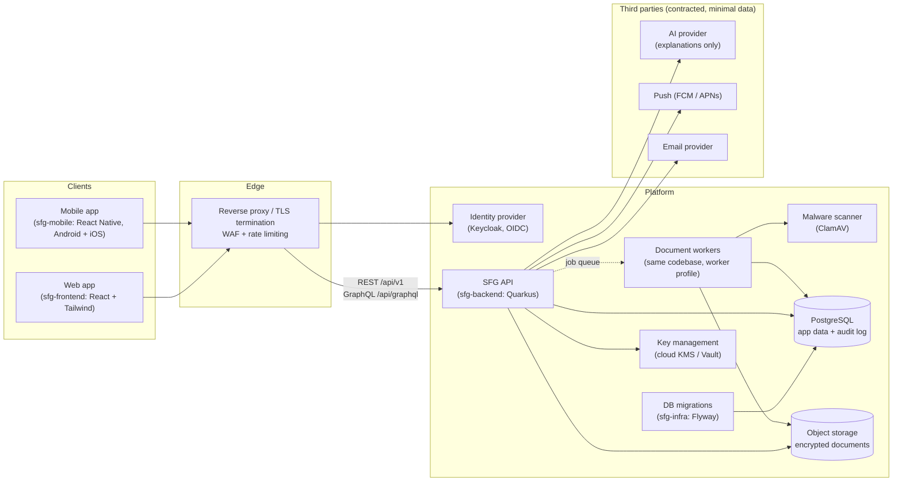
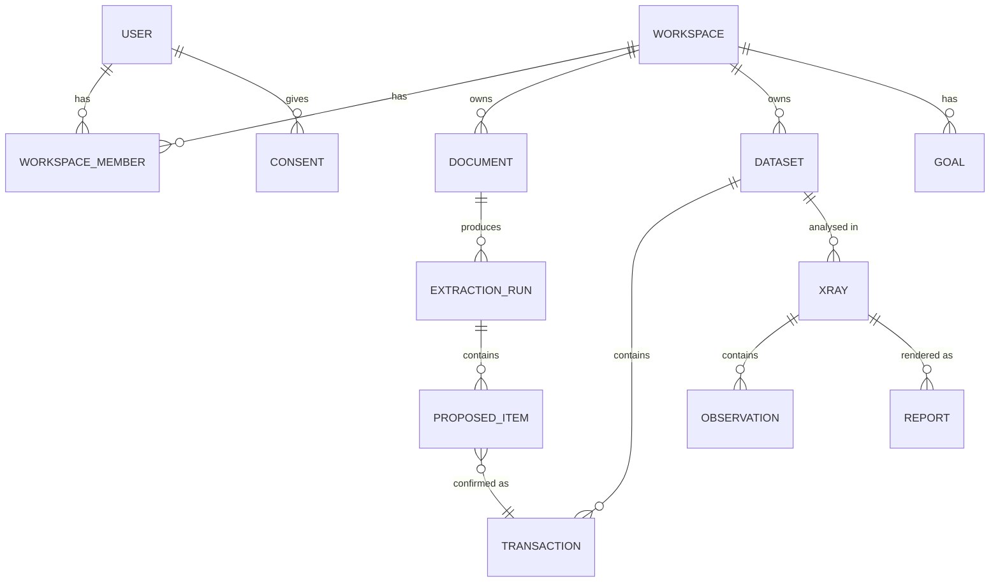
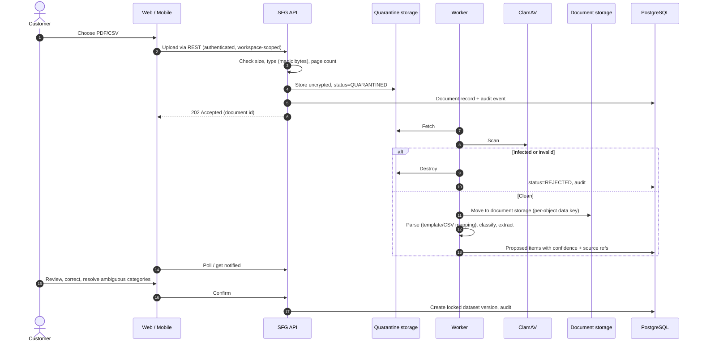
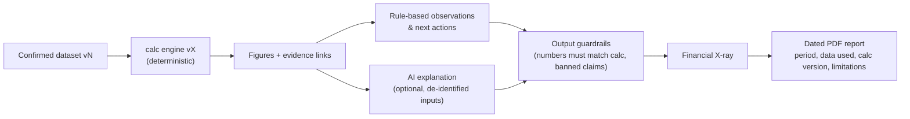
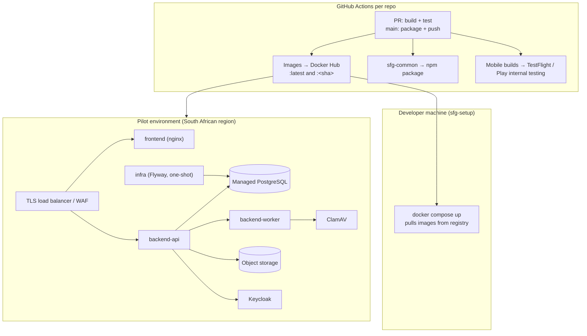

# SFG (Set Financial Goals): High-Level Design

| | |
|---|---|
| **Status** | Draft v0.2 for review (v0.2: REST + GraphQL, sfg-infra, Docker Hub CI) |
| **Date** | 24 November 2026 |
| **Source** | *SFG Technical Development, Cybersecurity & Data Protection Brief* (Finance Blueprint (Pty) Ltd, 22 October 2026) |
| **Scope** | First release and controlled Johannesburg pilot (about 100 participants: 70 individuals, 30 small businesses) |

This document describes the target architecture for the SFG first release. It turns the brief into
components, data flows and controls, and lists the decisions that still need an owner. Items marked
**[Decision]** are proposals made here that should be confirmed; items marked **[Open]** are listed in
[section 12](#12-open-questions).

---

## 1. Goals and constraints

### 1.1 What the first release must do

From the brief (section 3):

**Personal financial health**
- Onboarding and profile setup.
- Secure upload of payslips, about three months of bank statements, and optional debt documents.
- Extraction of data from those documents, shown to the customer for review and correction.
- A confirmation step where the customer resolves ambiguous transaction categories or extracted values.
- A **Financial X-ray**: cash flow, debt, savings, progress towards goals.
- Transparent, evidence-based observations and suggested next actions. The customer keeps decision-making control.
- Goal setup and tracking, weekly progress notifications, and a 30-day review.
- Dated financial-health reports that state the reporting period, the data used, and limitations.

**Basic small-business (SME) pilot**
- Secure upload of business bank statements and invoices.
- Basic business cash-flow visibility and goal planning.
- Separation of personal and business records, including when one person uses both.
- Limited decision support suitable for a controlled pilot.

### 1.2 Design principles (from brief 3.3 and section 4)

1. **Security and privacy first.** Secure upload and processing come before features. No live pilot with real data until legal/privacy review, controls, testing and approvals are complete.
2. **Documents in, not bank feeds.** PDF and CSV uploads only. No direct bank integrations and no promise of automatic monitoring in release 1.
3. **Deterministic numbers.** Every financial figure comes from a deterministic, versioned, tested and auditable calculation engine. AI may explain and suggest, but never calculates the numbers or overrides calculation controls.
4. **Customer in control.** Extracted data is a proposal until the customer confirms it. Suggestions are advice, not decisions.
5. **No credit-score claims.** Credit-readiness guidance is never presented as a bureau score or a lending decision.
6. **Proportionate.** Sized for a 100-person pilot. Prefer a small number of well-understood components over a distributed platform.

### 1.3 Explicit non-goals for release 1

- Direct bank / open-banking integrations.
- Automatic, continuous account monitoring.
- Official credit scores or lending decisions.
- Formats other than PDF and CSV (unless confirmed during design, see [Open] Q4).
- Multi-user business accounts (accountant/staff access), unless confirmed (Q9).
- High-scale, multi-region infrastructure.

---

## 2. Architecture overview

SFG is built as **one backend service (a modular monolith) with two clients**. For a pilot of this size,
a single deployable backend with strong internal module boundaries is cheaper to secure, test and operate
than microservices, and modules can be split out later if needed. **[Decision]**

**Key technology choices** (proposals, to confirm in Stage 1):

| Concern | Choice | Why |
|---|---|---|
| Backend | Quarkus (Java 21 LTS) | Stated in project setup; strong OIDC, security and native-image support |
| API style | REST (`/api/v1`, OpenAPI) **and** GraphQL (`/api/graphql`, SmallRye GraphQL) over one shared service layer | REST for simple, cacheable and file-upload calls; GraphQL lets the X-ray and dashboard screens fetch exactly what they need in one round trip |
| Schema migrations | Flyway, owned by the separate **sfg-infra** repo | Schema changes are reviewed and versioned on their own; Hibernate never generates DDL |
| Database | PostgreSQL 16 | Relational integrity for financial data; row-level security for tenant separation |
| Document storage | S3-compatible object storage (MinIO locally, cloud bucket in pilot) | Keeps large binaries out of the DB; per-object encryption and lifecycle rules |
| Identity | Keycloak (self-hosted) **[Decision]** | Open source, OIDC/PKCE, MFA, runs in docker-compose; avoids per-user SaaS fees and keeps identity data in-region |
| Async jobs | PostgreSQL-backed job queue (e.g. Quartz/JobRunr or `SKIP LOCKED` table) **[Decision]** | Pilot volumes are tiny; avoids running Kafka/RabbitMQ |
| Malware scanning | ClamAV sidecar | Uploaded files are untrusted input |
| Hosting | Containers in a South African cloud region (e.g. AWS af-south-1 or Azure South Africa North) **[Open] Q1** | Keeps personal information in-country, simplifies POPIA section 72 |

---

## 3. Repositories and components

All repositories live at `github.com/sdebie`.

| Repo | Purpose | Main contents |
|---|---|---|
| **sfg-parent** | Project documentation and cross-repo decisions | This HLD, architecture decision records (`docs/adr/`), threat model, security and POPIA control register, roadmap |
| **sfg-infra** | Database schema and local database | Flyway migrations (`db/migration`), dev seed data (`db/seed/dev`), a `docker-compose.yml` for a local PostgreSQL, and a small Quarkus app that applies the migrations |
| **sfg-setup** | Run the whole system locally and for the pilot | `docker-compose.yml`, env templates, startup and seed scripts. Compose **pulls** published images (details deferred) |
| **sfg-common** | Code and contracts shared between clients | API contract and generated TypeScript client, shared types and validation, domain constants, design tokens |
| **sfg-backend** | The SFG API and document workers | Quarkus application (REST + GraphQL), calculation engine. No DDL: it reads the schema from sfg-infra |
| **sfg-frontend** | Customer web app | React + Tailwind SPA |
| **sfg-mobile** | Customer mobile app | React Native app for Android and iOS |

### 3.1 sfg-backend (Quarkus)

A single Quarkus application, deployed in two roles from the same image: **api** (serves HTTP) and
**worker** (processes document jobs). Internal modules, each with its own package, tables and tests:

| Module | Responsibility |
|---|---|
| `identity` | Maps OIDC identities to SFG users; profile; consent records; MFA enforcement hooks |
| `workspace` | Personal and business workspaces, membership, and the tenant context applied to every request |
| `documents` | Upload intake, validation, quarantine, malware scan, encrypted storage, retention and deletion |
| `extraction` | Parsers for PDF and CSV (payslips, bank statements, invoices, debt documents); produces *proposed* data with confidence scores and source references (page/line) |
| `review` | Customer review and correction of extracted data; ambiguous-category resolution; confirmation and locking of a dataset |
| `ledger` | Confirmed transactions, categories, income, debts and balances per workspace |
| `calc` | **Deterministic calculation engine**: cash flow, debt ratios, savings rate, goal projections, SME cash-flow. Pure functions, `BigDecimal`, versioned, no I/O |
| `xray` | Assembles the Financial X-ray from `calc` outputs, with evidence links back to source transactions |
| `goals` | Goal setup, progress tracking, the 30-day review schedule |
| `guidance` | Rule-based observations and next actions; optional AI-written explanations behind safeguards (section 7) |
| `reports` | Dated PDF reports with period, data used, calc version and limitations |
| `notifications` | Weekly progress and review reminders via push and email; user preferences |
| `audit` | Append-only audit log of security and data events |
| `admin` | Minimal operator functions for the pilot (support lookup, deletion requests) with strict, audited access |

Notes:
- **Calculation engine discipline.** `calc` has no dependency on frameworks or AI. Each run records the engine version and a hash of its inputs, so any figure in a report can be reproduced. Golden test vectors (agreed with Finance Blueprint) gate every change.
- **Persistence.** Hibernate ORM with Panache, with `quarkus.hibernate-orm.database.generation=none`. The schema comes only from sfg-infra (section 3.6). All workspace-owned tables carry `workspace_id`.
- **APIs.** Two front doors onto the same services:
  - **REST/JSON** under `/api/v1` (JAX-RS), with OpenAPI generated by SmallRye OpenAPI at `/q/openapi` and published to sfg-common. Used for uploads, downloads (reports), commands and anything that benefits from plain HTTP semantics.
  - **GraphQL** at `/api/graphql` (SmallRye GraphQL). Used for read-heavy screens such as the Financial X-ray, goals and dashboards. Mutations are allowed where they mirror a REST command.
  - Both call the same `service` layer and share DTOs, so validation, authorization and audit happen once, in the service, not in each API. Resources stay thin.
  - GraphQL-specific controls: query depth and complexity limits, no introspection or GraphQL UI in production, and errors that do not leak internals.
- **Code layout.** `api/rest`, `api/graphql`, `dto`, `entity`, `mapper` (MapStruct), `service`, `exception`, with the modules above as sub-packages as they arrive. `Workspace` is the first worked example end to end.
- **Operations endpoints.** `/q/health` and `/q/metrics` (Prometheus), restricted at the reverse proxy.

### 3.2 sfg-frontend (React + Tailwind)

- Vite + React + TypeScript + Tailwind CSS.
- Routing by workspace (`/w/:workspaceId/...`) with a clear personal/business switcher and visual distinction between modes.
- Main areas: onboarding, uploads, review and confirm, Financial X-ray, goals, reports, settings (consent, notifications, data export/deletion).
- Uses the typed API client and shared validation from sfg-common.
- **Session model [Decision]:** the backend acts as a backend-for-frontend for the web app. Quarkus OIDC handles the login redirect and keeps the session in an `HttpOnly`, `Secure`, `SameSite=Strict` cookie, so access tokens are never exposed to browser JavaScript. Strict Content Security Policy; no third-party scripts or trackers on authenticated pages.
- Served as static files by nginx (own container image).

### 3.3 sfg-mobile (React Native)

- React Native with TypeScript for Android and iOS (Expo with a custom dev client is an option, **[Open] Q7**).
- Same feature set as web; document capture from files and, if confirmed, from the camera (Q4).
- **Auth:** OIDC Authorization Code + PKCE via the system browser (AppAuth). Refresh tokens stored in the iOS Keychain / Android Keystore only; short-lived access tokens kept in memory. Optional biometric unlock.
- **On-device data:** no financial documents or reports cached at rest beyond the current session; uploaded files are removed from app storage after a successful upload. Sensitive screens hidden from the app switcher and, on Android, protected against screenshots.
- Push notifications via FCM (Android) and APNs (iOS); notification content carries no financial figures (for example, "Your weekly progress update is ready").
- Uses the same sfg-common client and types as the web app.

### 3.4 sfg-common

Shared by sfg-frontend and sfg-mobile (and, for the contract, by sfg-backend). **[Open] Q8** confirms the
exact boundary. Proposed contents:

- **API contract:** the OpenAPI document and the GraphQL schema exported from sfg-backend, with generated TypeScript clients/types (e.g. OpenAPI generator for REST, GraphQL Code Generator for queries).
- **Shared types and validation:** request/response types and Zod schemas used for client-side validation.
- **Domain constants:** transaction category taxonomy, goal types, document types, currency/number formatting for ZAR.
- **Copy and disclaimers:** standard wording such as "This is not a credit score or lending decision", so web and mobile say the same thing.
- **Design tokens:** colours, spacing and typography shared by Tailwind (web) and the React Native theme.

Published as a versioned npm package (e.g. GitHub Packages). If Java-side shared code is ever needed,
it becomes a separate Maven artifact in the same repo.

### 3.5 sfg-setup

- `docker-compose.yml` that pulls published images from Docker Hub for: `backend-api`, `backend-worker`, `frontend`, `infra` (runs the Flyway migrations, then exits), `postgres`, `keycloak`, `minio`, `clamav`, and for local use only `mailpit` (fake email). The backend starts only after the migration container has finished successfully.
- `.env.example` with every setting documented; no real secrets committed.
- Startup scripts: create buckets, import the Keycloak realm, load synthetic seed data. Migrations are run by the sfg-infra image, not by the backend.
- The same compose definition can run a single-host pilot environment with production overrides, or be translated to the chosen cloud platform later (details deferred, see section 10).

### 3.6 sfg-infra (database schema)

- **Owns the PostgreSQL schema.** Versioned Flyway migrations in `src/main/resources/db/migration` (starting with `V1.0.0__initial_schema.sql`) and synthetic seed data in `db/seed/dev`, which is never applied outside dev and test.
- **Local database:** its `docker-compose.yml` starts PostgreSQL 16 for development (`sfg_db`, user `sfg`).
- **Applying migrations:** a small Quarkus application with Flyway applies them. The same image runs as a one-shot job before the backend starts in compose and in the pilot. **[Decision]** Migrations run under a dedicated schema-owner role; the backend connects with a lower-privilege application role that cannot change the schema. This is also where row-level security policies (6.2) will live.
- **How the backend uses it:** sfg-backend tests check out sfg-infra next to it (`../sfg-infra`, overridable with `-Dsfg-infra.dir`), and Quarkus Dev Services starts a throwaway PostgreSQL that the migrations and dev seed are applied to. This keeps entities and schema in step without the backend owning DDL.
- **Rules for schema changes:** migrations are forward-only and never edited after merge; a backend change that needs a new column merges the sfg-infra migration first; destructive changes go through expand-then-contract across two releases.

---

## 4. Domain model (simplified)

- **User:** one person, linked to an identity in Keycloak.
- **Workspace:** the unit of data separation. Type `PERSONAL` or `BUSINESS`. A user has at most one personal workspace and zero or more business workspaces.
- **Dataset:** a confirmed, locked set of transactions and figures for a period. X-rays and reports always point at a specific dataset version, so a dated report is reproducible.
- **Proposed item vs transaction:** extraction output stays a *proposal* until the customer confirms it; only confirmed data feeds `calc`.

---

## 5. Key data flows

### 5.1 Document upload, extraction and review

Extraction strategy **[Decision]**:
1. **CSV:** deterministic column mapping per known bank format, with a manual mapping fallback.
2. **Text-based PDF:** text extraction (Apache PDFBox/Tika) plus bank- and payslip-specific templates for the main South African banks and common payroll formats.
3. **Scanned or unknown PDFs:** marked "needs manual entry" in release 1, or OCR if confirmed (Q4). AI-based extraction, if used at all, is only an assistant that pre-fills proposals, under the same safeguards as section 7, and never skips the customer review.

### 5.2 Financial X-ray, guidance and report

- Every figure shown links back to the transactions it came from ("why am I seeing this?").
- Observations are generated from rules first; AI only rewords and explains them in plain language.
- Reports are immutable once generated and record dataset version, calc version, generation date and the standard limitations text.

### 5.3 Goals and notifications

- A scheduled job runs weekly per workspace, recomputes goal progress from the latest confirmed dataset, and sends a progress notification (push and/or email per user preference).
- A 30-day review is scheduled at goal creation and prompts the customer to upload newer statements and revisit the plan.
- Because there is no bank feed, progress reflects the data the customer has uploaded; the UI says so (brief 3.3).

---

## 6. Security architecture

Mapped to brief section 4. A formal threat model (STRIDE per data flow above) is a Stage 1 deliverable and will refine these controls.

### 6.1 Identity, authentication and sessions
- OIDC via Keycloak. Web uses the backend-for-frontend cookie session; mobile uses Authorization Code + PKCE.
- **MFA required** for all customers (TOTP or passkeys/WebAuthn; SMS OTP only as a fallback, **[Open] Q6**).
- Strong password policy with breached-password checks, account lockout and throttling on login and OTP.
- Short access-token lifetime (5 to 10 minutes), rotating refresh tokens, idle session timeout (e.g. 15 minutes) and absolute timeout; re-authentication before sensitive actions (export, delete account, change MFA).

### 6.2 Authorization and personal/business separation
- Every request runs in a **workspace context**; the backend checks the caller's membership and role on that workspace for every call (deny by default).
- **Defence in depth:** PostgreSQL row-level security on all workspace-owned tables, with the workspace id set per transaction, so a missed check in code still cannot return another workspace's rows.
- Object storage keys are prefixed by workspace and never guessable; documents are only served through the API after an authorization check (no public URLs).
- Explicit UI separation between personal and business modes; no cross-workspace aggregation in release 1.
- Operator/admin access is separate (own realm or role, MFA, IP-restricted), least privilege, and every access is audited.

### 6.3 Encryption
- **In transit:** TLS 1.2+ (prefer 1.3) everywhere, HSTS on the web; TLS between internal services where the platform allows.
- **At rest:** encrypted database volumes and backups; object storage server-side encryption **plus** application-level envelope encryption of each document with its own data key wrapped by a KMS master key.
- **Sensitive fields** (SA ID number, account numbers) are encrypted at the column level and masked in the UI and logs.
- Keys live in a managed KMS or HashiCorp Vault, never in code or images; rotation documented.

### 6.4 Secure document handling
- Allow-list of types (PDF, CSV), validated by content, not extension. Size and page-count limits. PDFs with JavaScript or embedded files are rejected or sanitised.
- Quarantine, then malware scan, then promotion to document storage. Parsers run in the worker with limited privileges and resource limits.
- **Retention and deletion:** originals are kept only as long as needed for review and evidence (proposed: deleted 90 days after the dataset is confirmed, **[Open] Q3**); deletion removes the object and destroys its data key (crypto-shredding), so copies in backups become unreadable.

### 6.5 Audit logging and monitoring
- Append-only audit log for logins, MFA changes, uploads, views/downloads of documents and reports, confirmations, exports, deletions and all admin actions: who, what, when, from where, workspace.
- Application logs contain no document contents, no figures and no unmasked identifiers.
- Centralised logs and metrics with alerts for brute-force attempts, unusual download volumes, authorization failures and job failures. Monitoring level for the pilot to be agreed (**[Open] Q11**).

### 6.6 Secure development lifecycle
- Protected `main` branches, pull-request review, signed commits encouraged.
- CI (GitHub Actions) on every PR: build and tests (sfg-backend checks out sfg-infra so tests run against the real migrations), SAST (e.g. CodeQL/Semgrep), dependency scanning (Dependabot/Renovate, OWASP Dependency-Check, `npm audit`), secret scanning, container image scanning (Trivy), SBOM generation.
- Defined vulnerability handling: triage SLA by severity, remediation and retest.
- Only synthetic or anonymised data in development and test environments.

### 6.7 Backup, recovery and incident response
- Encrypted, automated database backups with point-in-time recovery; object storage versioning; backups kept in-region.
- Proposed pilot targets: RPO 24 hours or better, RTO 1 business day (**[Open] Q12**). A restore test is part of Stage 3.
- Incident response plan covering detection, containment, POPIA section 22 notification to the Information Regulator and affected customers, and post-incident review.

---

## 7. AI safeguards

AI is optional and limited to **explaining** results and drafting next-step wording (brief 3.3, section 4).

1. **No numbers from AI.** All figures come from `calc`. AI receives the computed figures and rule-based observations, not raw documents.
2. **Data minimisation and de-identification.** No names, ID numbers, account numbers, employer names or raw transaction descriptions are sent. Inputs are aggregates and category-level facts.
3. **Contractual controls.** Provider must offer no training on customer data, zero or minimal retention, a data processing agreement and, ideally, in-region or adequately protected processing (POPIA section 72). Provider choice: **[Open] Q5**.
4. **Output guardrails.** Generated text is checked before display: any number must match a `calc` value; banned phrasing (credit score, "you qualify", lending decisions, guaranteed outcomes) is blocked; fallback to the rule-based text if checks fail.
5. **Transparency.** AI-written text is labelled; the customer can see the underlying figures and evidence.
6. **Logging.** Prompts and outputs are logged in de-identified form for quality review, with the same retention rules as other data.
7. **Kill switch.** AI explanations can be turned off by configuration without affecting the X-ray.

---

## 8. Privacy and POPIA support

Technical support for POPIA controls. **Legal advice and formal compliance sign-off are outside this design and must be obtained separately** (brief section 4).

| POPIA condition / right | Technical support |
|---|---|
| Accountability | Named Information Officer (Finance Blueprint, **[Open] Q2**); control register in sfg-parent |
| Processing limitation and consent | Versioned, recorded consent at onboarding per purpose (processing documents, AI explanations, notifications); withdraw at any time |
| Purpose specification | Data used only for the customer's own financial-health analysis; no reuse for model training or marketing without separate consent |
| Further processing | Controls preventing reuse of identifiable documents by AI or third parties (section 7) |
| Information quality | Customer review and correction step; editable profile |
| Openness | In-app privacy notice; report limitations section |
| Security safeguards (s19) | Section 6 of this document |
| Data subject participation | Self-service export of personal data and reports; correction; account and workspace deletion with crypto-shredding |
| Special and children's information | Not collected; onboarding restricted to adults (18+) |
| Cross-border transfer (s72) | Hosting in South Africa; third parties assessed and contracted |
| Breach notification (s22) | Incident response plan (6.7) |
| Retention (s14) | Retention schedule per data type, enforced by scheduled jobs (**[Open] Q3**) |

---

## 9. Testing and assurance

- **In development (included):** unit tests (especially `calc` with golden vectors), API integration tests (Quarkus + Testcontainers), contract tests against the OpenAPI spec, authorization tests that prove workspace isolation, UI tests for web (Playwright) and mobile (Detox or Maestro), dependency and static scanning in CI.
- **Independent assurance (separate, per brief section 5):** vulnerability assessment and penetration test of web, mobile and API; authentication and session testing; document upload abuse tests (malicious PDFs, oversized files, polyglots); access-control and personal/business separation testing; findings report with severity, remediation and retest.
- **Pilot readiness:** restore test, incident tabletop exercise, user testing, go/no-go review against measurable acceptance criteria (Stage 3).

---

## 10. Deployment overview

- **Environments:** local (compose, synthetic data), test/staging (synthetic data only), pilot (real data, only after go/no-go).
- **CI pattern (per repo, GitHub Actions):**
  - `build.yml` on every pull request: build and run the tests. sfg-backend also checks out the private sfg-infra repo (needs a `SFG_INFRA_TOKEN` secret, a fine-grained read-only token) so tests run against the real migrations.
  - `build-<component>.yml` on push to `main`: compile with Maven (or the JS build), build a small runtime image from a `Dockerfile.runtime` (for the backend, `eclipse-temurin:21-jre-alpine` with the pre-built `target/quarkus-app`), and push it to **Docker Hub** as `<DOCKERHUB_USERNAME>/sfg-<component>:latest` and `:<git sha>`. Needs `DOCKERHUB_USERNAME` and `DOCKERHUB_TOKEN` secrets.
  - Images: `sfg-backend`, `sfg-infra`, `sfg-frontend`. Mobile builds go to the app stores instead.
- **Image hygiene [Decision]:** Docker Hub repositories should be **private**, since they hold the application (**[Open] Q15**). Images get a vulnerability scan (e.g. Trivy) before push. sfg-setup pins the `:<sha>` tag for anything beyond local dev; `:latest` is for local convenience only.
- **Pilot hosting:** container platform in a South African region with managed PostgreSQL, object storage and KMS; exact platform deferred (**[Open] Q1**). A single-host compose deployment is acceptable for staging.
- **Mobile distribution:** TestFlight (iOS) and Google Play internal/closed testing for pilot participants.
- **Configuration and secrets:** environment variables injected from the platform's secret store; nothing secret in repos or images.

---

## 11. Proposed delivery staging

Aligned with the brief's six-month plan.

| Stage | Focus | Architecture outputs |
|---|---|---|
| **1. Planning and design** (about month 1) | Requirements, architecture, threat model, acceptance criteria | This HLD finalised, ADRs, threat model, POPIA control register, calc specification and golden test vectors, API contract v1 |
| **2. Development and integration** (about months 2 to 5) | Secure foundations first, then features | Auth + workspaces + audit + upload pipeline → extraction and review → calc and X-ray → goals and notifications → guidance with AI safeguards → reports → SME pilot features |
| **3. Validation and pilot readiness** (about month 6) | Testing and go/no-go | Pen test and retest, restore test, user testing, documentation, handover, go/no-go |

**Recommended deferrals** to keep release 1 secure and achievable: bank integrations, OCR of scanned documents (unless pilot data shows it is essential), formats beyond PDF/CSV, multi-user business accounts, in-app chat with AI, offline mobile mode, and native-image builds.

---

## 12. Open questions

| # | Question | Owner (suggested) |
|---|---|---|
| Q1 | Which cloud provider and South African region will host the pilot? Any existing accounts or preferences? | Finance Blueprint / dev team |
| Q2 | Who is the Information Officer, and who provides legal/POPIA review and sign-off? | Finance Blueprint |
| Q3 | Retention periods for original documents, extracted data, reports, audit logs and closed accounts? | Finance Blueprint + legal |
| Q4 | Must release 1 handle scanned PDFs/photos (OCR, camera capture), or other formats such as XLSX/OFX? Which banks and payroll formats are in scope for the pilot? | Product |
| Q5 | Will AI explanations be in release 1, and which provider meets the no-training / retention / transfer requirements? | Product + security |
| Q6 | Accepted MFA methods (TOTP, passkeys, SMS fallback)? | Security |
| Q7 | React Native workflow: Expo (managed with dev client) or bare React Native? | Dev team |
| Q8 | Exact scope of sfg-common: TypeScript only (client, types, tokens), or Java artifacts as well? | Dev team |
| Q9 | Can a business workspace have more than one member (e.g. an accountant), or is it one owner in release 1? | Product |
| Q10 | What is the calculation specification (definitions of cash flow, debt ratios, savings rate, goal projections) and who signs off the golden test vectors? | Finance Blueprint |
| Q11 | What level of security monitoring is expected for the pilot (basic alerting vs managed SOC/SIEM)? | Finance Blueprint + AVeS |
| Q12 | Pilot availability, RPO and RTO targets? | Finance Blueprint |
| Q13 | Language support: English only for the pilot, or other South African languages? | Product |
| Q14 | Identity verification at onboarding: is SA ID verification / KYC needed for the pilot, or self-declared profiles? | Product + legal |
| Q15 | Docker Hub plan and visibility: are the image repositories private, and is Docker Hub acceptable for the pilot or should images move to a registry in the hosting provider? | Dev team |
| Q16 | Will the web and mobile apps use GraphQL, REST or both for reads? This decides which generated clients sfg-common ships first. | Dev team |

---

## Appendix A: Brief traceability

| Brief section | Covered in |
|---|---|
| 3.1 Personal financial health | 3.1, 5.1, 5.2, 5.3 |
| 3.2 SME pilot | 3.1 (`workspace`, `calc`), 4, 6.2 |
| 3.3 Principles and exclusions | 1.2, 1.3, 5.1, 7 |
| 4 Cybersecurity, privacy and data protection | 6, 7, 8 |
| 5 Independent testing | 9 |
| 6 Delivery approach | 11 |
| 7 Development scope items (IP, hosting, licences) | 3, 10; commercial items out of scope for this HLD |
